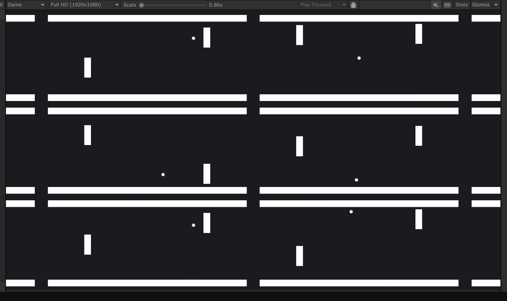
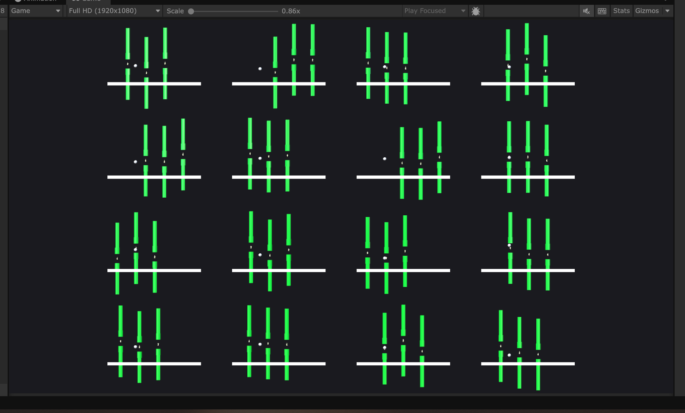

# TCC — Jogos Digitais com ML-Agents

Projeto de conclusão de curso da graduação em Jogos Digitais. Reúne três minigames em Unity, cada um com uma IA reativa escrita à mão (baseline) e, em desenvolvimento, uma IA treinada com **ML-Agents** (aprendizado por reforço).

| Jogo | Descrição | IA reativa (baseline) | IA treinada (ML-Agents) |
|---|---|---|---|
| **Pong** | Clone de Pong com energia para rebater | `Script_IaPong` | `AgentPong` — **treinado** (`Pong.onnx`) |
| **Flap** | Clone de Flappy Bird | `Script_IaFlap` | `AgentFlap` — código pronto, **treino pendente** |
| **Infinity** | Runner infinito com faixas e pulo | `Script_IaInfinity` | `AgentInfinity` — código pronto, **treino pendente** |

## Objetivo do TCC

Comparar uma IA reativa programada à mão com uma IA aprendida por reforço, dentro do mesmo jogo, e entregar uma **build WebGL** em que a IA treinada roda no navegador.

Estratégia adotada:

- **Treino no Editor** (Python + ML-Agents, fora do navegador).
- **Inferência na build WebGL** apenas com o arquivo `.onnx` exportado.
- Rede pequena (2 camadas × 64 neurônios), observações vetoriais e `RayPerceptionSensor` (sem observações visuais), para manter a inferência leve.

## Estado atual

- [x] Projeto migrado para **Unity 6000.3.8f1**.
- [x] Pacote `com.unity.ml-agents` 4.2.0 instalado.
- [x] Ambiente Python de treino (`ml/venv`) com versões fixadas em `ml/requirements.txt`.
- [x] Scripts de treino: `ml/treinar.bat`, `ml/graficos.bat` (TensorBoard) e configs `ml/config_{pong,flap,infinity}.yaml`.
- [x] Cenas de treino geradas por menu do Editor (`TCC > ML-Agents > Criar cena de treino`), em `Assets/_ME/Scenes/Treino/`.
- [x] **Pong**: agente `AgentPong` implementado e treinado (runs `Pong01` e `Pong02`); modelo `Assets/_ME/Models/Pong.onnx`.
- [x] **Flap** e **Infinity**: agentes `AgentFlap` e `AgentInfinity` implementados, com configs de treino prontas.
- [ ] **Flap**: treinar, validar e exportar o `.onnx`.
- [ ] **Infinity**: treinar, validar e exportar o `.onnx` (é o mais difícil; fica por último).
- [ ] Avaliar as IAs treinadas contra as reativas (número de partidas e métricas, registrados em `ml/RESULTADOS.md`).
- [ ] Integrar no jogo a escolha de quem joga: **Humano / IA reativa / IA treinada**.
- [ ] Build WebGL com os `.onnx` incluídos, testada no navegador (FPS estável e comportamento igual ao do Editor).

## Estrutura do repositório

```
Assets/
  _ME/
    Scripts/
      Flap/        # Script_FlapManager, Script_IaFlap (reativa), AgentFlap (ML-Agents), arena de treino
      Infinity/    # Script_InfinityManager, Script_IaInfinity (reativa), AgentInfinity (ML-Agents), arena de treino
      Pong/        # Script_PongManager, Script_IaPong (reativa), AgentPong (ML-Agents), arena de treino
      Inicio/ Menu/  # telas iniciais
    Scenes/        # cenas de jogo, menu e início
      Treino/      # cenas de treino (uma por jogo)
    Editor/        # menus que criam as cenas de treino
    Models/        # .onnx exportados, usados na inferência
ml/
  config_pong.yaml, config_flap.yaml, config_infinity.yaml   # hiperparâmetros do PPO
  requirements.txt                                            # dependências Python fixadas
  treinar.bat, graficos.bat                                   # treino e TensorBoard
  venv/, results/                                             # ambiente e resultados (não versionados)
PLANO_MLAGENTS.md                                             # plano detalhado das fases
```

## Versões

| Item | Versão |
|---|---|
| Unity | 6000.3.8f1 |
| com.unity.ml-agents (pacote Unity) | 4.2.0 |
| Python | 3.10 |
| mlagents (treino) | 1.1.0 |
| torch | 2.2.2 |

## Como treinar

1. Abra o projeto no Unity 6000.3.8f1.
2. Crie a cena de treino pelo menu **TCC > ML-Agents > Criar cena de treino** (se ainda não existir).
3. No terminal, na raiz do projeto:

```bash
ml\treinar.bat pong Pong03
```

4. Quando aparecer `Listening on port 5004`, dê **Play** na cena de treino do jogo.
5. Para parar sem perder progresso: `Ctrl+C` no terminal, espere a mensagem `Exported` e só então pare o Play.
6. Para acompanhar as métricas:

```bash
ml\graficos.bat
```

Depois abra `http://localhost:6006`.

7. Copie o `.onnx` gerado em `ml/results/<run-id>/` para `Assets/_ME/Models/` e atribua-o no componente **Behavior Parameters** do agente (modo *Inference Only*).

Para recriar o ambiente Python:

```bash
uv venv ml/venv --python 3.10
uv pip install --system-certs --python ml/venv/Scripts/python.exe -r ml/requirements.txt
```

> Se o Gradle, o Package Manager ou o `uv` falharem com erro de certificado (`PKIX path building failed`), é o Avast interceptando HTTPS: desligue temporariamente o *Web Shield* e tente de novo.

## Próximos passos

1. Treinar o **Flap** (`ml\treinar.bat flap Flap01`), validar e exportar o `.onnx`.
2. Treinar o **Infinity** (`ml\treinar.bat infinity Infinity01`), simplificando observações e recompensas se não convergir.
3. Medir as IAs treinadas contra as reativas e registrar os resultados em `ml/RESULTADOS.md`.
4. Implementar a seleção de jogador (Humano / IA reativa / IA treinada) nas cenas finais.
5. Gerar a build WebGL e validar FPS e comportamento no navegador. Se o FPS cair: reduzir a rede, aumentar o `DecisionPeriod` ou diminuir os raycasts.

Detalhes de cada fase, recompensas, observações e riscos estão em [PLANO_MLAGENTS.md](PLANO_MLAGENTS.md).

## Créditos e assets

- Modelos de cidade e veículos: pacotes *CubexCube - Free City Pack I* e *Simple Vehicle Pack* (em `Assets/Packages/`).
- TextMesh Pro e fontes Liberation Sans (em `Assets/Packages/`).

---





